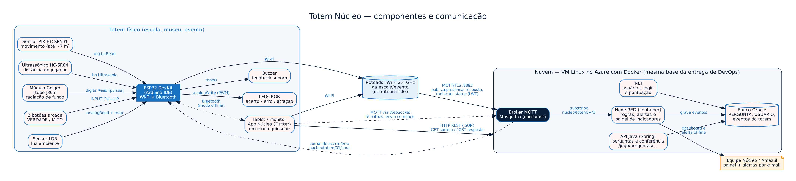
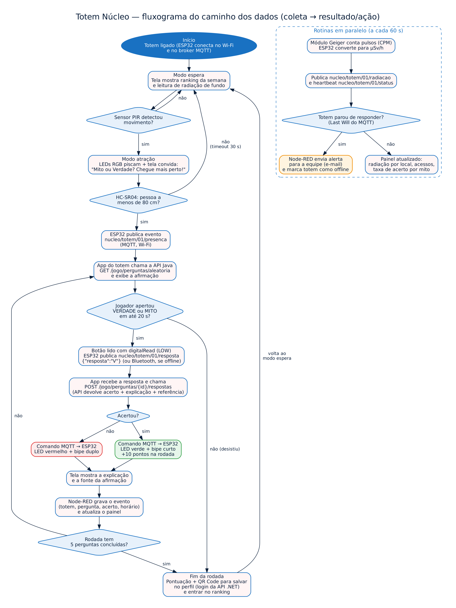

# ⚛️ Núcleo — Totem IoT "Mito ou Verdade"

Challenge 2026 · Sprint 1 · FIAP — Análise e Desenvolvimento de Sistemas (2TDS)
Disciplina: **Disruptive Architectures: IoT, IoB & Generative IA**
Empresa parceira: **Amazul / CTMSP — Programa Nuclear da Marinha**

> Proposta **conceitual**: esta entrega descreve como IoT e Redes se aplicam ao projeto Núcleo. O sistema físico não foi construído nesta Sprint.

🎥 **Vídeo de apresentação (YouTube, não listado):** <https://youtu.be/SZBqGL-cVQk>

---

## 👥 Equipe

| Integrante | RM |
|---|---|
| Cassio Alexandre Ribeiro de Moraes | 567295 |
| Davi Isac Colin Pereira | 567265 |
| Hugo Souza de Jesus | 568542 |
| Matheus Peres Moraes de Jesus | 567300 |
| Pedro Gonçalves Rodrigues | 567651 |

---

## 1. O problema

A tecnologia nuclear ainda é pouco compreendida e costuma ser associada só a usinas, acidentes e armas. Mitos como "toda radiação é perigosa" ou "o lixo nuclear brilha em verde" geram medo e distorcem o debate sobre energia, saúde e clima.

O **Núcleo** é a resposta do grupo: um app gamificado em Flutter, com o jogo **Mito ou Verdade** (cartões de arrastar com explicação imediata) e o puzzle **Equilíbrio da Cidade**. A API Java guarda e confere as perguntas; o módulo .NET cuida dos usuários e da pontuação.

O app, porém, depende de a pessoa **baixar e abrir** o aplicativo. Quem mais tem medo da energia nuclear dificilmente vai procurá-lo por conta própria.

## 2. Onde IoT e Redes entram: o Totem Núcleo

**O que é:** um totem físico instalado em escolas, museus de ciência, feiras, eventos e espaços de divulgação da Amazul e do CTMSP, que **leva o jogo até as pessoas**.

**Que necessidades atende:**

| Necessidade do projeto | Como o totem resolve |
|---|---|
| Alcançar quem não instalaria o app | O totem **percebe** quem se aproxima e convida para jogar, sem cadastro nem download |
| Tornar a radiação algo concreto, não abstrato | Um **contador Geiger** mede a radiação natural do ambiente **naquele momento** e mostra que ela está em toda parte e é inofensiva nesses níveis |
| Saber quais mitos ainda convencem as pessoas | Cada resposta vira um dado anônimo: a Amazul vê **quais mitos mais enganam**, por local (base de **IoB — Internet of Behaviors**) |
| Manter os totens funcionando em vários locais | Os totens enviam sinal de vida; se um ficar offline, a equipe recebe um **alerta** |

**Como funciona em uma frase:** o totem detecta a pessoa, inicia uma rodada de 5 afirmações, recebe a resposta por **botões físicos**, confere na API, responde com **luz e som**, mostra a explicação e, no fim, oferece um QR Code para a pessoa salvar a pontuação e continuar jogando no app.

### 2.1 Os blocos básicos da IoT no totem

A proposta cobre os seis blocos básicos da IoT vistos em aula:

| Bloco | Como aparece no Totem Núcleo |
|---|---|
| **Identificação** | **QR Code** (identificação óptica) no fim da rodada, que liga a pontuação ao usuário do app |
| **Sensores** | PIR (movimento), ultrassônico (distância), LDR (luz ambiente), botões (resposta) e contador Geiger (radiação) |
| **Comunicação** | Wi-Fi com MQTT e HTTP para a nuvem; **Bluetooth** como modo offline entre o ESP32 e o tablet |
| **Computação** | Microcontrolador **ESP32**, que processa as leituras no próprio totem antes de enviar (edge computing) |
| **Semântica** | Mensagens em **JSON** e tópicos padronizados (`nucleo/totem/<id>/<dado>`), que qualquer sistema consegue interpretar |
| **Serviços** | Ranking, painel de indicadores para a Amazul e alertas de manutenção por e-mail |

O totem é um **sistema ciberfísico**: sensores e atuadores no mundo físico, com os dados representados em tempo real no painel, como um "gêmeo virtual" de cada totem. O alerta de totem offline é um exemplo de **Internet de Serviços (IoS)**: o sistema avisa a equipe sem que ninguém precise conferir.

---

## 3. Componentes



| Componente | O que mede ou executa | Onde fica no totem |
|---|---|---|
| **ESP32 DevKit** | Microcontrolador que lê os sensores, controla LEDs e buzzer e se comunica pela rede. O Arduino UNO usado nas aulas não tem rede; o ESP32 (previsto no cronograma da disciplina) é programado no **mesmo Arduino IDE**, com `setup()` e `loop()`, e já tem **Wi-Fi e Bluetooth integrados** | Dentro do gabinete, na base |
| **Sensor PIR HC-SR501** | Detecta **movimento** a até ~7 m. Tira o totem do modo espera e ativa o modo atração | Topo do totem, voltado para o corredor |
| **Sensor ultrassônico HC-SR04** | Mede a **distância** da pessoa (lido com a biblioteca `Ultrasonic`). Só inicia o jogo quando ela para a menos de 80 cm, evitando partidas falsas de quem só passa | Frente do totem, altura do peito |
| **Sensor de luz LDR** | Mede a **luminosidade do ambiente**. Ajusta o brilho dos LEDs: mais forte em pátios claros, mais fraco em auditórios escuros | Topo do totem, ao lado do PIR |
| **2 botões arcade** (verde = VERDADE, vermelho = MITO) | **Entrada** da resposta do jogador. Grandes e coloridos, funcionam para crianças e pessoas com pouca familiaridade com telas | Painel frontal, abaixo da tela |
| **Módulo contador Geiger** (tubo J305) | Conta os pulsos de radiação (CPM). O ESP32 converte para **µSv/h** e a tela compara com exemplos do dia a dia (banana, voo, raio-X) | Lateral do totem, em compartimento ventilado |
| **LEDs RGB de alto brilho** | **Atuador visual**: piscam no modo atração, ficam verdes no acerto e vermelhos no erro | Moldura da tela |
| **Buzzer** | **Atuador sonoro**: bipe curto no acerto, bipe duplo no erro | Interno, com furação no painel |
| **Tablet ou monitor com o app Núcleo** (Flutter, modo quiosque) | Exibe a afirmação, a explicação, a fonte, o ranking e a leitura de radiação. Reaproveita o app do grupo | Frente do totem |
| **Roteador Wi-Fi 2.4 GHz** (ou roteador 4G em eventos) | Dá acesso à internet para o ESP32 e o tablet | Rede do local ou dentro do totem |

---

## 4. Comunicação

### 4.1 Dentro do totem
Sensores, botões, LEDs e buzzer são ligados por fio aos pinos do ESP32. A leitura e o acionamento usam as mesmas funções praticadas em aula:

| Componente | Tipo de sinal | Funções no código |
|---|---|---|
| Botões VERDADE / MITO | Entrada digital, resistor **pull-up interno** | `pinMode(pino, INPUT_PULLUP)` e `digitalRead()`: o botão apertado lê `LOW` |
| Sensor PIR | Entrada digital | `digitalRead()`: `HIGH` quando há movimento |
| Contador Geiger | Entrada digital (pulsos) | `digitalRead()` contando pulsos por minuto (CPM) |
| Ultrassônico HC-SR04 | Trigger (saída) e echo (entrada) | Biblioteca `Ultrasonic`, que devolve a distância em centímetros |
| LDR | Entrada **analógica** | `analogRead()` + `map()` para converter a leitura em brilho |
| LEDs RGB / buzzer | Saída digital e **PWM** | `analogWrite()` para cor e brilho dos LEDs e `tone()` para o bipe |
| Depuração | Serial | `Serial.begin()` e `Serial.println()` no Monitor Serial durante os testes |

### 4.2 Do totem para a nuvem
| Trecho | Rede / protocolo | Por quê |
|---|---|---|
| ESP32 → roteador | **Wi-Fi 802.11 b/g/n (2.4 GHz)** | Nativo do ESP32 e disponível em escolas e eventos |
| ESP32 ↔ broker | **MQTT** sobre TCP/IP, com **TLS (porta 8883)** e usuário/senha por totem | Protocolo leve, de publicação e assinatura, feito para dispositivos IoT com pouca memória e rede instável |
| Tablet ↔ API Java | **HTTP REST (JSON)** | Reaproveita os endpoints que a API Java já tem |
| Tablet ↔ broker | **MQTT via WebSocket** | O app escuta os botões e devolve o comando de acerto/erro |
| ESP32 ↔ tablet (modo offline) | **Bluetooth** | Se o Wi-Fi do local cair, os botões continuam funcionando ligados direto ao tablet, que joga com perguntas salvas e envia os eventos quando a rede voltar |

O broker MQTT (**Mosquitto**) e o **Node-RED** rodam em **containers Docker numa VM Linux no Azure**, a mesma base usada na entrega de DevOps.

### 4.3 Tópicos MQTT
| Tópico | Quem publica | Conteúdo | QoS |
|---|---|---|---|
| `nucleo/totem/01/presenca` | ESP32 | `{"distancia_cm": 62}` | 0 |
| `nucleo/totem/01/resposta` | ESP32 | `{"resposta": "V"}` ou `{"resposta": "F"}` | 1 |
| `nucleo/totem/01/cmd` | App do totem | `{"resultado": "acerto"}` → LED verde e bipe | 1 |
| `nucleo/totem/01/radiacao` | ESP32 (a cada 60 s) | `{"cpm": 18, "usv_h": 0.12}` | 0 |
| `nucleo/totem/01/status` | ESP32 (a cada 60 s) | `online`; o **Last Will** do MQTT publica `offline` se o totem cair | 1 |

O `01` identifica o totem, então vários totens convivem no mesmo broker (`nucleo/totem/+/...`).

---

## 5. O que acontece com os dados

| Dado | Para onde vai | Como é processado | Quem usa |
|---|---|---|---|
| Resposta do jogador | Broker → app do totem → API Java (`POST /jogo/perguntas/{id}/respostas`) | A API confere V/F e devolve explicação e referência | Jogador (feedback imediato) |
| Evento da partida (totem, pergunta, acerto, horário) | Broker → Node-RED → Oracle | Agregado por totem, por pergunta e por dia | Amazul e equipe: **quais mitos mais enganam** e onde |
| Presença (PIR + ultrassônico) | Broker → Node-RED | Pessoas detectadas × partidas iniciadas = **taxa de conversão** do totem | Equipe: avaliar o melhor local e o horário de pico |
| Radiação (µSv/h) | Broker → app do totem e Node-RED | Média móvel; comparação com referências do cotidiano | Visitante (conteúdo educativo) e painel por local |
| Status / Last Will | Broker → Node-RED | Sem sinal → totem marcado como offline | Equipe de manutenção |
| Pontuação | QR Code → app → módulo .NET | Soma pontos ao usuário que fez login | Ranking no app e na tela do totem |

**Privacidade:** o totem **não coleta dados pessoais** (não há câmera nem microfone). Os eventos são anônimos; a pontuação só é ligada a uma pessoa se ela mesma escanear o QR Code e fizer login.

---

## 6. Respostas e benefícios gerados

- **Feedback imediato** ao jogador: LED verde ou vermelho, som e explicação com fonte na tela.
- **Radiação real e didática:** "agora este ambiente mede 0,12 µSv/h, igual a qualquer lugar da cidade; uma banana dá cerca de 0,1 µSv". Isso derruba o mito de que toda radiação é perigosa com uma medição, não só com texto.
- **Ranking atualizado** na tela do totem e no app, estimulando a pessoa a voltar.
- **Painel de indicadores** (Node-RED) para a Amazul: acessos, taxa de acerto por mito e por local, radiação medida em cada ponto. Os mitos mais errados orientam as próximas campanhas e perguntas do jogo.
- **Alerta automático** por e-mail quando um totem fica offline.
- **Ponte para o app:** o QR Code no fim da rodada transforma um contato rápido em um usuário recorrente.

---

## 7. Fluxograma

Caminho dos dados desde a coleta até o resultado ou ação:



---

## 8. Tecnologias previstas

| Camada | Tecnologia |
|---|---|
| Dispositivo | ESP32 (Arduino IDE), sensores PIR HC-SR501, HC-SR04 e LDR, módulo Geiger J305, botões, LEDs RGB, buzzer |
| Simulação do protótipo (próxima Sprint) | Wokwi (ESP32 + MQTT) ou Tinkercad (parte local com Arduino UNO) |
| Rede | Wi-Fi 2.4 GHz, Bluetooth, TCP/IP, MQTT com TLS, HTTP REST |
| Broker e integração | Eclipse Mosquitto, Node-RED (Docker em VM Azure) |
| Aplicação | App Núcleo em Flutter (modo quiosque), API Java Spring, módulo .NET |
| Dados | Oracle |

## 9. Próximos passos

1. Simular o ESP32 com os sensores e o broker MQTT no Wokwi.
2. Subir Mosquitto e Node-RED em containers na VM do Azure.
3. Adicionar ao app a assinatura MQTT dos botões e o modo quiosque.
4. Criar no banco a tabela de eventos do totem para o painel.

## 📁 Estrutura do repositório

```
README.md               Proposta completa (este arquivo)
docs/
├── fluxograma.png      Fluxograma do caminho dos dados
├── fluxograma.svg
├── fluxograma.dot      Fonte editável (Graphviz)
├── arquitetura.png     Componentes e comunicação
├── arquitetura.svg
└── arquitetura.dot     Fonte editável (Graphviz)
```

Para regerar as imagens: `dot -Tpng -Gdpi=150 docs/fluxograma.dot -o docs/fluxograma.png` (idem para `arquitetura.dot`).

---

Projeto acadêmico desenvolvido em parceria com a **Amazul**. Repositórios das demais disciplinas: [github.com/nucleo-challenge](https://github.com/nucleo-challenge).
